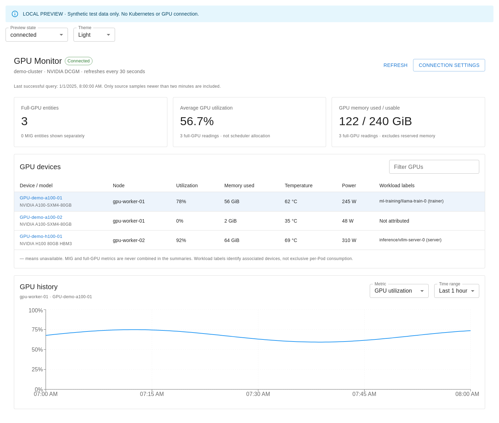

# GPU Monitor for Headlamp

A standalone Headlamp plugin for NVIDIA GPU telemetry from **DCGM Exporter and Prometheus**.

The plugin provides a GPU inventory from recent metrics, utilization, framebuffer memory, temperature, power draw, and 1/6/24-hour history. It also adds GPU sections to Node details and Pods requesting `nvidia.com/gpu` or `nvidia.com/mig-*` resources.

This repository is prepared for a first public release. No GitHub repository, release or Artifact Hub listing has been published yet. Plugin loading and browser integration have been tested in Headlamp **0.45.0** with Plugin SDK **0.14.0**, using synthetic API responses. Desktop integration and real GPU hardware require separate validation. See the [validation record](docs/VALIDATION.md).



## Requirements

- Headlamp with plugin loading enabled.
- NVIDIA GPUs with compatible drivers and DCGM Exporter.
- Prometheus scraping the exporter at intervals shorter than two minutes (15–30 seconds recommended).
- Permission to access the Prometheus Service through the Kubernetes API proxy.
- Node.js 22.12+ and npm 10+ to build from source. They are not required to run an installed plugin.

Installing this plugin does not install drivers, the GPU Operator, exporters or Prometheus. Existing monitoring infrastructure is reused.

## Build and package

```sh
npm ci
npm run validate
npm run package
npm run checksums
```

The installable archive is `artifacts/headlamp-gpu-monitor-0.1.0.tar.gz`, with a companion `artifacts/SHA256SUMS`. The SDK refuses to overwrite an existing archive; move the previous archive aside before packaging the same version again.

## Install locally

Verify the downloaded archive in the directory containing both files:

```sh
sha256sum -c SHA256SUMS
```

Extract into Headlamp's configured plugin directory:

```sh
tar -xzf headlamp-gpu-monitor-0.1.0.tar.gz -C /path/to/headlamp/plugins
```

The resulting layout must be:

```text
plugins/
└── headlamp-gpu-monitor/
    ├── main.js
    ├── package.json
    ├── README.md
    ├── LICENSE
    └── docs/
```

For an in-cluster deployment, mount that directory into the Headlamp container at its configured `-plugins-dir`. Restart Headlamp or refresh the browser after plugin reload. Desktop plugin directories depend on OS and installation; use Headlamp's documented plugin directory. Desktop loading has not yet been tested for this release.

## Connect to Prometheus

1. Select a single cluster in Headlamp and open **GPU Monitor** in the sidebar.
2. Open **Connection settings**.
3. Enter the Prometheus Service namespace, name, port and HTTP/HTTPS protocol. Defaults are suggestions only: `monitoring`, `prometheus-operated`, `9090`.
4. If Prometheus is served under a subpath, enter it, for example `/prometheus`.
5. For centralized Prometheus, enter the label and literal value identifying this cluster, for example `cluster=production`. Without a filter, all GPU series visible at that endpoint are eligible.
6. Save. The plugin queries immediately and polls 30 seconds after each completed refresh.

Settings are stored by Headlamp's ConfigStore per cluster in this browser/profile. They contain no credentials and are not a server-wide deployment policy. Queries use the signed-in user's existing Headlamp authentication; a separate Prometheus login flow is not supported.

The request path is:

```text
/api/v1/namespaces/NAMESPACE/services/http:SERVICE:PORT/proxy/api/v1/query
```

Historical data uses the equivalent `query_range` endpoint. Requests have a 15-second timeout, at most 1,000 series per response, and roughly 241 points per series. A limit warning is displayed when results may be truncated. Long histories depend on Prometheus retention.

## Metrics and interpretation

| Display         | DCGM Exporter metric      | Unit                               |
| --------------- | ------------------------- | ---------------------------------- |
| GPU utilization | `DCGM_FI_DEV_GPU_UTIL`    | Percent                            |
| GPU memory used | `DCGM_FI_DEV_FB_USED`     | MiB, converted to GiB in the table |
| GPU memory free | `DCGM_FI_DEV_FB_FREE`     | MiB                                |
| Temperature     | `DCGM_FI_DEV_GPU_TEMP`    | Celsius                            |
| Power draw      | `DCGM_FI_DEV_POWER_USAGE` | Watts                              |

- This is a **telemetry inventory**, not an authoritative hardware inventory. A GPU without recent exporter samples does not appear. Scheduler capacity and allocation counts are not calculated in v0.1.0.
- A valid zero is shown as zero. Missing, unsupported or invalid metrics appear as `—`. There is no simulated-data fallback in the installed plugin.
- The source sample must be newer than 120 seconds. This is enforced using PromQL `timestamp()`, because instant-query timestamps themselves represent evaluation time. History uses the same freshness rule at every evaluation step, leaving gaps instead of connecting missing samples.
- After a refresh error, existing readings are explicitly marked stale. The displayed time is the last successful query, not a hardware sample timestamp.
- GPU identity uses node, UUID and MIG instance identifiers. Repeated scrape targets and workload label copies are deduplicated; gauge values are never summed across duplicate series. At equal timestamps the maximum duplicate value is used; avoid scraping incompatible exporters for one GPU.
- Summaries use full-GPU entities only. MIG rows remain separate and may have unavailable utilization, temperature or power, depending on DCGM/hardware support. MIG instance values are not added to parent GPU values.
- Usable framebuffer memory is `used + free`; it excludes reserved memory. Partial summary coverage is shown under each card.
- Node mapping recognizes `Hostname`, `hostname`, `node` and `kubernetes_node`. Device identity requires `UUID` or `uuid`.
- Pod mapping uses DCGM's `namespace`, `pod`, `container` labels, preferring `exported_*` when Prometheus renames conflicting labels. Configure scraping to preserve workload labels correctly. A misconfigured target's Pod labels cannot be reliably distinguished from workload labels by the UI.
- Workload labels show device association, not exclusive per-Pod consumption. Time-sliced/MPS/shared GPUs do not have guaranteed per-container attribution. DRA ResourceClaims and allocation discovery are outside v0.1.0.
- Utilization percentage is a busy-time metric, not a measure of achieved FLOPS or model efficiency.

## Access and deployment considerations

The existing Kubernetes identity needs `get` on `services/proxy` for the chosen namespace/Service. Cluster discovery and resource detail pages retain Headlamp's own Node/Pod read requirements. Grant only the access your deployment needs; no RBAC changes are made by the plugin.

The Prometheus API can expose data across namespaces. Frontend filters are **not** authorization controls. Enforce tenant isolation in the monitoring backend or an authorized query gateway. Direct arbitrary URLs and credentials are intentionally not accepted in the connection form.

## Development and local preview

```sh
npm run preview
```

The preview listens on `0.0.0.0:5178`. Open `http://127.0.0.1:5178` locally, or `http://<host-ip>:5178` from another machine on your network. This standalone preview is prominently labelled **synthetic test data** and supports light/dark themes and loading/empty/error/stale states. It does not connect to Kubernetes and does not validate hardware measurements.

```sh
npm test
npm run test:browser
npm run test:promql
npm run storybook
```

Browser checks use Playwright. By default they use `/usr/bin/google-chrome`; set `CHROME_PATH` to your browser executable, or adapt the Playwright launch configuration for another platform. Storybook includes connected, loading, denied, empty, stale and unconfigured stories.

`test:promql` uses Docker and the official Prometheus 3.5.0 image to evaluate the actual query against controlled samples. The full Headlamp browser test requires `HEADLAMP_TEST_URL`; otherwise it is explicitly skipped. Follow [the validation instructions](docs/VALIDATION.md) to run it against an isolated local Headlamp.

`npm start` runs the official SDK's development watcher and may install/update the development plugin in your local Headlamp profile. Enable Headlamp Plugin Development Mode only for trusted source code.

See [local validation and review](docs/LOCAL-REVIEW.zh-TW.md) and [release preparation](docs/RELEASING.md).

## References

- [Headlamp plugin development](https://headlamp.dev/docs/latest/development/plugins/)
- [DCGM Exporter](https://github.com/NVIDIA/dcgm-exporter)
- [DCGM metrics and labels](https://docs.nvidia.com/datacenter/dcgm/latest/reference/dcgm-exporter-metrics.html)
- [NVIDIA GPU sharing limitations](https://docs.nvidia.com/datacenter/cloud-native/gpu-operator/latest/gpu-sharing.html)
- [Prometheus query API](https://prometheus.io/docs/prometheus/latest/querying/api/)

## License

Apache-2.0. See [LICENSE](LICENSE).
